# MoreMoney 设计规范

- 版本：v1.0
- 日期：2026-11-09
- 状态：视觉与交互方向暂定，作为 ArkUI 实现依据
- 设计源文件：`MoreMoney-UI.html`
- 截图目录：`screenshots/`
- 产品范围：仅支出记账、多账本、预算、分类统计、私密账本、单向自动备份

---

## 1. 产品与设计定位

MoreMoney 是一个鸿蒙原生的支出账本，核心不是“记流水”，而是“让预算看得见”。

设计上刻意避开两种常见做法：

1. 不做成只展示大数字的财务仪表盘。预算、剩余、每天可用必须和流水在同一套节奏里。
2. 不做成纯表格工具。分类、图标、色彩和分组要足够轻快，让“记一笔”不成为负担。

最终方向是**暖中性底色 + 靛蓝主色 + 彩色分类**：

- 暖中性底色负责稳定、耐看，适合长期打开。
- 靛蓝负责操作、选中、进度和品牌识别。
- 分类色负责区分，不承担品牌含义。
- 支出红、预算绿、提醒黄只表达状态，不参与装饰。

---

## 2. 设计原则

### 2.1 预算先于流水

首页打开先看到本月支出、预算进度、剩余和每天可用，再看到每一笔。预算卡在视觉上比流水列表更靠前。

### 2.2 单手记一笔

记一笔页把分类放在上半屏，把账本、成员、日期、金额和键盘放在下半屏。最常用的“保存”固定在键盘区右上角，拇指不需要跨屏。

### 2.3 隐私是一等状态

私密账本不只是“点进去要密码”：

- 列表里金额直接打码。
- 锁定时不计入预算合计。
- 导出、备份、统计都需要重新确认。
- 会话内短时免重复验证，避免每次记账都打断。

### 2.4 金额始终可藏

所有出现金额的页面都有眼睛按钮。隐藏时不仅遮数字，也遮进度条、图表金额、日历热力和预算比例，避免从图形反推金额。

### 2.5 分类按“记住的位置”排

“常用”分组的成员随使用频率变化，但组内始终按拼音排序。用户记住的是位置，不是每次变化的排序。

---

## 3. 画布与布局

### 3.1 手机画布

| 项目 | 规格 |
|---|---|
| 设计宽度 | 392 px（按 1 design px ≈ 1 vp 落地） |
| 设计高度 | 844 px |
| 手机外框 | 宽 392，内边距 9，圆角 52 |
| 屏幕内容区 | 374 × 826，圆角 44 |
| 状态栏 | 高 44，左右内边距 24，字号 11 / 700 |
| 底部导航 | 高 62 |
| 底部手势条区 | 高 18，手势条 116 × 4，圆角 999 |
| 主内容滚动区 | 约 702 高（826 − 62 − 18 − 44，按实际 flex 计算） |
| 页面左右安全边距 | 16 |

> 392 是设计基准。HarmonyOS 实际设备常见 360–420vp，落地时优先压缩间距，不建议缩小 8–9px 的辅助文字；窄屏建议把 8–9px 提到 10vp 以上。

### 3.2 页面结构

四个一级页：

1. 记账本
2. 预算
3. 图表
4. 设置

二级页：

- 账本管理
- 分类管理
- 数据与备份
- 搜索
- 记一笔（全屏面板）
- 私密解锁（底部弹层）

### 3.3 页面头部

| 类型 | 规格 |
|---|---|
| 一级页头部 | padding `10 18 0`；标题 25 / 700；副标题 9 / 400；右侧动作 gap 6 |
| 二级页头部 | padding `6 16 0`；返回按钮 34；标题 17 / 700；右侧动作 gap 10 |
| 记一笔顶部 | 高 48；关闭按钮 34；标题 13 / 700；右侧“仅支出” 9 |
| 首页 Hero | padding `44 20 78`；底部圆角 30；状态栏覆盖在渐变上 |
| 首页内容 | margin-top −54；左右 16；底部 150（给 FAB 留空间） |

---

## 4. 色彩系统

### 4.1 品牌色

| Token | 浅色 | 深色 | 用途 |
|---|---|---|---|
| `--brand` | `#6366F1` | `#818CF8` | 装饰、进度填充、日历热力、图表面积 |
| `--brand-ink` | `#4338CA` | `#A5B4FC` | 文字、选中、描边、次级按钮文字 |
| `--brand-soft` | `#E0E7FF` | `#2E2A5E` | 选中图标底、激活 pill |
| `--brand-wash` | `#EEF2FF` | `#1E1B3A` | 轻背景、预算空状态、分类选中底 |
| `--btn-bg` | `#4338CA` | `#A5B4FC` | 主按钮、FAB、保存 |
| `--btn-fg` | `#FFFFFF` | `#1E1B3A` | 主按钮上的文字/图标 |

主要对比度（WCAG）：

- 浅色：`#4338CA` on white = 7.90:1；white on `#4338CA` = 7.90:1
- 浅色：`#4338CA` on `#EEF2FF` = 7.07:1
- 深色：`#A5B4FC` on `#1E1B3A` = 8.27:1
- 深色：`#A5B4FC` on `#121017` = 9.47:1
- 深色：`#1E1B3A` on `#A5B4FC` = 8.27:1

### 4.2 中性色

| Token | 浅色 | 深色 | 用途 |
|---|---|---|---|
| `--bg` | `#FAF8F7` | `#121017` | 页面底色 |
| `--surface` | `#FFFFFF` | `#1C1925` | 卡片、弹层 |
| `--surface-2` | `#F5F0F1` | `#25212E` | 次级块、输入框、关闭态背景 |
| `--surface-3` | `#ECE4E6` | `#302A3B` | 更深的次级块、关闭态开关 |
| `--ink` | `#272231` | `#F4F0FA` | 主文字、数字 |
| `--ink-2` | `#6B6272` | `#C3BCCD` | 次级文字 |
| `--ink-3` | `#756B7B` | `#9C93A8` | 说明、辅助标签 |
| `--line` | `#EEE4E6` | `#332D40` | 发丝线、边框 |
| `--chart-surface` | `#FFFFFF` | `#1C1925` | 图表卡背景 |
| `--bezel` | `#15121B` | `#15121B` | 手机外框 |
| `--scrim` | `rgba(24,20,48,.42)` | `rgba(0,0,0,.58)` | 弹层遮罩 |
| `--tab-bg` | `rgba(255,255,255,.84)` | `rgba(28,25,37,.86)` | 底部导航毛玻璃底 |

辅助文字对比度：浅色 `#756B7B` on `#FAF8F7` = 4.78:1；深色 `#9C93A8` on `#121017` = 6.43:1。

### 4.3 语义色

| Token | 浅色 | 深色 | 用途 |
|---|---|---|---|
| `--expense` | `#C62F3D` | `#FF9A9A` | 支出金额、负数 |
| `--good` | `#137A57` | `#4FD1A0` | 预算剩余、安全 |
| `--warn` | `#8A5200` | `#F0B45A` | 私密标记、预警文字 |

语义色只表达状态，不复用为分类色。

### 4.4 图表分类色

图表色是一套独立调色板，已经通过色盲相邻色对校验：

| Slot | 示例分类 | 浅色 | 深色 |
|---|---|---|---|
| 1 | 交通 | `#2A78D6` | `#3987E5` |
| 2 | 餐饮 | `#EB6834` | `#D95926` |
| 3 | 居住 | `#1BAF7A` | `#199E70` |
| 4 | 娱乐 | `#EDA100` | `#C98500` |
| 5 | 购物 | `#E87BA4` | `#D55181` |
| 其他 | 其他 | `#B8AAB1` | `#7D6C75` |

校验结果：

- 相邻色对 CVD ΔE：浅色 9.1，深色 8.4（目标 ≥ 8）
- 常视觉 ΔE：浅色 19.6，深色 19.3（下限 ≥ 15）
- 浅色下青、黄、品红对白底低于 3:1，因此饼图直接标注比例，图例同时给出名称、比例和金额
- 深色下全部 ≥ 3:1

分类色还包含：

| Token | 浅色 | 深色 | 主要用途 |
|---|---|---|---|
| `--c6` | `#6250D6` | `#9085E9` | 学习、私密账本封面 |
| `--c7` | `#008300` | `#4CAF50` | 备用分类 |
| `--c8` | `#E34948` | `#E66767` | 医疗 |

### 4.5 成员色

| 成员 | 浅色 | 深色 | 说明 |
|---|---|---|---|
| 自己 | `#2A78D6` | `#6FB0FF` | 15% 透明底 + 首字 |
| 家人 | `#C94B7B` | `#FF9CC1` | 15% 透明底 + 首字 |
| 孩子 | `#137A57` | `#4FD1A0` | 15% 透明底 + 首字 |

成员是本地标签，不进入品牌色体系。

### 4.6 Hero 渐变

| Token | 浅色 | 深色 |
|---|---|---|
| `--hero-a` | `#4F46E5` | `#312E81` |
| `--hero-b` | `#4338CA` | `#25225F` |
| `--hero-c` | `#312E81` | `#181638` |
| `--on-hero` | `#FFFFFF` | `#FFFFFF` |
| `--hero-glass` | `rgba(22,18,60,.28)` | `rgba(255,255,255,.09)` |
| `--hero-line` | `rgba(255,255,255,.18)` | `rgba(255,255,255,.14)` |
| `--hero-glow` | `rgba(255,255,255,.18)` | `rgba(140,150,255,.12)` |

渐变角度 152deg，节点 0 / 52% / 100%。白色小字在 `#4F46E5` 上为 6.29:1，安全。

### 4.7 色彩使用规则

1. 品牌靛蓝不进入图表分类色。图表用独立的 1–5 + 其他。
2. 支出红、预算绿、提醒黄不用于装饰或分类。
3. 私密账本锁定时，名称可显示，金额、比例、进度条必须打码。
4. 深色模式不是简单反色：主按钮变成浅色底 + 深色字，保证对比度。
5. 所有颜色必须通过 token 使用，不在组件里写死十六进制。

---

## 5. 字体与数字

### 5.1 字体族

```text
UI 中文：
"Noto Sans SC", "HarmonyOS Sans SC", "PingFang SC", "Microsoft YaHei", system-ui, sans-serif

数字/金额：
"Baloo 2", "Noto Sans SC", system-ui, sans-serif
```

说明：

- 高保真原型使用 Noto Sans SC + Baloo 2。
- HarmonyOS 原生实现优先使用系统 HarmonyOS Sans SC；Baloo 2 需随包内置或替换为系统圆体数字。
- 金额、预算、统计数字统一使用 `font-variant-numeric: tabular-nums`，保证纵向对齐。

### 5.2 字号与字重

| 角色 | 字号 | 字重 | 备注 |
|---|---:|---:|---|
| 首页本月支出 | 42 | 700 | 金额，Baloo 2，红色 |
| 趋势主数字 | 27 | 700 | 日均/最高 |
| 记一笔金额 | 26 | 700 | 表达式，不带负号 |
| 预算环中心 | 24 | 700 | 百分比 |
| 饼图中心总额 | 23 | 700 | 金额 |
| 账本标题 / 解锁标题 | 19 | 700 | Hero 书册 / 私密账本 |
| 一级页标题 | 25 | 700 | 记账本、预算、图表、设置 |
| 二级页标题 | 17 | 700 | 账本管理、分类管理、数据 |
| 预算合计数字 | 17 | 700 | 三列摘要 |
| 区块标题 | 14 | 700 | 最近记录 |
| 账单金额 | 14 | 700 | 红色 |
| 记一笔标题 | 13 | 700 | 顶部 |
| 流水标题 | 13 | 600 | 主信息 |
| 设置标题 | 12 | 500 | 设置行主文字 |
| 账本名 | 13 | 700 | 账本卡 / 预算行 |
| 图例名 | 11 | 500 | 图表图例 |
| 分类名 | 10 | 500 | 分类按钮 |
| 辅助正文 / 说明 | 10 | 400 | 卡片内说明 |
| 表单/选择器/标签 | 9 | 500 | 账本、成员、日期、备注 |
| 微标签 / 图表轴 | 8 | 400 | 坐标轴、占比标签 |
| 日历金额 | 7 | 400 | 日历格内 |

### 5.3 行高

- 大数字：1.0–1.05
- 标题：1.25–1.35
- 正文：1.55–1.65
- 说明/注释：1.6

---

## 6. 尺寸系统

### 6.1 间距

基础节奏：**4 / 6 / 8 / 10 / 12 / 16 / 20 / 24 / 32**。

组件内部会用到 5 / 7 / 9 / 11 / 13 / 15 的半步值，用于在 392 宽画布内做视觉微调。

常用：

| 场景 | 间距 |
|---|---|
| 页面左右安全边距 | 16 |
| 卡片内边距 | 13 / 15 / 17 / 19 |
| 卡片间距 | 9 / 12 / 13 |
| 列表行内边距 | `11 13` / `12 13` / `9 12` |
| 图标与文字 | 4 / 5 / 6 / 8 / 10 / 11 |
| 标题与内容 | 6 / 8 / 10 / 12 |
| 区块之间 | 13 / 18 / 20 / 22 / 24 |

### 6.2 圆角

| 角色 | 圆角 |
|---|---:|
| 手机外框 / 屏幕 | 52 / 44 |
| Hero 底部 | 30 |
| 摘要卡 / 预算卡 / 图表卡 | 24 |
| 备份卡 | 22 |
| 流水卡 / 设置卡 / 账本卡 / 预算摘要 / 空状态卡 | 20 |
| 分类分组卡 | 18 |
| 分类按钮 / 图标 | 16 / 14 |
| 弹层 / 备注编辑器 | 28 / 13 |
| 输入框 / 选择器 / 备注框 | 10 |
| 键盘 / 小保存按钮 | 11 |
| 主按钮 / 次级按钮 | 14 |
| 提示条 | 12 |
| 胶囊 / 开关 / 眼睛按钮 | 999 / 50% |

### 6.3 阴影

| Token | 浅色 | 深色 |
|---|---|---|
| `--shadow` | `0 24px 70px rgba(50,40,110,.16)` | `0 24px 70px rgba(0,0,0,.5)` |
| `--card-shadow` | `0 10px 28px rgba(50,40,110,.08)` | `0 10px 28px rgba(0,0,0,.32)` |
| `--nav-shadow` | `0 -8px 24px rgba(50,40,110,.06)` | `0 -8px 24px rgba(0,0,0,.26)` |

单独阴影：

- FAB：`0 16px 34px color-mix(in srgb, var(--btn-bg) 38%, transparent)`
- 备注编辑器：`0 12px 28px color-mix(in srgb, var(--ink) 12%, transparent)`
- 饼图分类圆片的投影：`0 5px 14px color-mix(in srgb, var(--c) 18%, transparent)`

规则：阴影只给需要“浮起”的元素——摘要卡、预算卡、FAB、备注编辑器、分类圆片。普通列表用发丝线，不用阴影。

### 6.4 触控尺寸

| 元素 | 尺寸 | 说明 |
|---|---|---|
| 主按钮 | 高 46 | 全宽 |
| 保存（记一笔） | 38 高 | 右上角 |
| 数字键 | 42 高 | 3 列 |
| 运算符键 | 约 32 高 | 1 列 5 键，宽度约 88 |
| 分类按钮 | 最小 78 高，图标 52 | 4 列，约 84 × 78 |
| 选择器 | 36 高 | 3 等分 |
| 备注框 | 38 高 | 金额右侧 |
| 图标按钮 | 34 | 建议原生实现扩大热区到 44 × 44 |
| 眼睛按钮 | 34 | 同上 |
| FAB | 70 | 右下 |
| 底部 Tab | 62 高 | 整格可点 |
| 开关 | 38 × 22 | 建议热区 44 × 44 |

---

## 7. 全局组件

### 7.1 手机、状态栏、底部导航

| 组件 | 规格 |
|---|---|
| 手机 | 392 × 844；padding 9；外框 `#15121B`；圆角 52；内屏圆角 44 |
| 状态栏 | 44 高；左右 24；字号 11 / 700；首页 Hero 上白字，其余页面墨色 |
| 状态栏背景 | 非 Hero 页面使用 `--bg` 84% + 18px blur；滚动后首页也切到该背景 |
| 底部 Tab | 62 高；4 等分；上边框 1px `--line`；背景 `--tab-bg` + 18px blur |
| Tab 图标 | 38 × 25 胶囊；图标 20；选中 `--brand-soft` 底 + `--brand-ink` |
| Tab 文案 | 9px；选中加粗 |
| 手势条 | 116 × 4；`--ink-3` 40% |

### 7.2 按钮

| 类型 | 规格 |
|---|---|
| 主按钮 | 高 46；圆角 14；背景 `--btn-bg`；文字 `--btn-fg`；13 / 700 |
| 小保存按钮 | 高 38；圆角 11；12 / 700；图标 14 |
| 次级按钮 | 高 46；圆角 14；边框 `--line`；背景 `--surface`；文字 12 / 600 |
| 图标按钮 | 34 × 34；圆形；边框 `--line`；背景 `--surface`；图标 17 |
| Hero 按钮 | 36 × 36；圆形；`--hero-glass` 底 + `--hero-line` 边；图标 17 |
| 眼睛按钮 | 34 × 34；圆形；激活时 `--brand-wash` + `--brand-ink` |
| FAB | 70 × 70；`--btn-bg`；图标 29；右 16 / 下 92 |
| 迷你操作 | padding `5 9`；胶囊；`--brand-wash` / `--brand-ink`；9 / 700 |

### 7.3 卡片与列表

| 组件 | 规格 |
|---|---|
| 摘要卡 | padding 19；圆角 24；border 1px `--line` 76%；`--card-shadow` |
| 流水卡 | 圆角 20；背景 `--surface`；1px `--line` |
| 流水行 | grid `42px 1fr auto`；gap 11；padding `11 13`；行间 1px `--line` |
| 流水图标 | 42 × 42；圆角 14；分类色 13% 底；图标 21 |
| 流水标题 | 13 / 600；单行省略 |
| 流水副行 | 9 / 400；`--ink-3`；成员首字 15px 圆点 |
| 流水金额 | 14 / 700；`--expense`；tabular-nums |
| 设置卡 | 圆角 20；背景 `--surface`；行 padding `11 13`；行间 1px `--line` |
| 设置图标 | 31 × 31；圆角 10；`--surface-2` 底；图标 16 |
| 设置标题 / 副标题 | 12 / 500；9 / 400 |
| 账本卡 | padding 13；圆角 20；gap 9 |
| 账本封面 | 46 × 46；圆角 14；分类色 16% 底；图标 23 |
| 账本进度 | 高 5；圆角 999；`--surface-2` 轨 + `--brand` 填充 |
| 空预算进度 | 高 5；透明底 + 1px dashed `--line` |

### 7.4 表单与选择器

| 组件 | 规格 |
|---|---|
| 选择器 | 高 36；圆角 10；1px `--line`；背景 `--surface`；9 / 500；三列等分，内容居中 |
| 备注框（收起） | 高 38；圆角 10；1px `--line`；背景 `--surface`；flex 1，最小 72；图标 13；9px |
| 备注编辑器 | 高 108；padding 10；圆角 13；背景 `--surface`；阴影；textarea 62 高，圆角 9，11px |
| 搜索框 | 高 36；圆角 999；1px `--line`；背景 `--surface`；11px |
| 密码框 | 高 45；圆角 13；背景 `--surface-2`；12px |
| 开关 | 38 × 22；圆角 999；关闭 `--surface-3`；开启 `--btn-bg`；滑块 16 |
| 分段控件 | padding 3；圆角 13；背景 `--surface-2`；按钮高约 30，圆角 10，10 / 600 |

### 7.5 图标与徽标

- 全部图标使用 24 × 24 viewBox 的线性图标，stroke 1.8，圆头圆角。
- 分类图标在按钮内为 26px（52 圆片），在流水行为 21px（42 圆片），在分类管理 chip 为 11–12px。
- 分类色底统一为 `color-mix(in srgb, 分类色 13%, var(--surface))`。
- 徽标：胶囊，padding `1 6`，8 / 600。
  - 默认：`--brand-wash` / `--brand-ink`
  - 私密：`--warn` 12% 底 / `--warn` 文字
- 成员首字：15 × 15 圆，成员色 15% 底，8 / 700。

---

## 8. 页面规范

### 8.1 记账本（首页）

结构：

1. Hero（靛蓝渐变，状态栏覆盖）
2. 书册切换 chips
3. 月份 + 左右箭头
4. 本月支出摘要卡（上移 54，压在 Hero 上）
5. 最近记录 + 成员筛选
6. 按天分组的流水列表
7. 右下 FAB

关键尺寸：

| 元素 | 规格 |
|---|---|
| Hero | padding `44 20 78`；底部圆角 30；渐变 152deg |
| 书册 chip | padding `6 10 6 6`；圆角 12；10 / 600；封面 22 |
| 月份大字 | 32 / 700（Baloo 2） |
| 摘要卡 | padding 19；圆角 24；上移 54 |
| 本月支出 | 42 / 700；`--expense`；`−¥1,286.40` |
| 预算进度 | 高 8；圆角 999；填充靛蓝渐变；末端 12 白点 + 3px 靛蓝描边 |
| 摘要统计 | 3 列；数字 16 / 700；标签 9 |
| 分组头 | 9px；左侧 5 点；右侧当天支出 |
| FAB | 70；右 16；下 92；图标 29 |

状态：

- 金额隐藏时，摘要金额、已用/剩余、统计数字、每日小计、流水金额全部模糊；FAB 和分类图标保持清晰。
- 私密账本 chip 显示锁，点击进入解锁。

### 8.2 记一笔

结构从上到下：

1. 顶部 48：关闭、记一笔、仅支出
2. 分类区（flex 1，可滚动）：常用、餐饮、出行、居家、购物、休闲、其他
3. 选择器行：账本、成员、日期（三列等分）
4. 金额/备注/保存行：金额与备注挨着，保存靠右
5. 计算器键盘：左运算符列、右数字区
6. 备注编辑器：点击备注后向下展开

关键尺寸：

| 元素 | 规格 |
|---|---|
| 分类分组头 | sticky；padding `8 2 6`；11 / 700；说明 8 |
| 分类网格 | 4 列；gap 8 |
| 分类按钮 | 最小 78 高；padding `7 2`；圆角 16；10px |
| 分类图标 | 52 × 52；圆角 16；图标 26 |
| 选中分类 | 1px `--brand-ink` 边；`--surface` 底；图标 2px `--brand-soft` 环 |
| 选择器 | 36 高；flex 1；圆角 10；9px |
| 金额显示 | 26 / 700；Baloo 2；`¥` 前缀；不出现负号 |
| 预览 | 9px；`合计 ¥15.00` / `金额需大于 0` / `无法计算` |
| 备注框 | 38 高；flex 1；最小 72；圆角 10；9px |
| 保存 | 38 高；圆角 11；12 / 700；右上角 |
| 键盘 | grid `1fr 3fr`；gap 6 |
| 运算符列 | 5 键：+、−、×、÷、退格；等分填充 |
| 数字区 | 3 列 × 4 行；7 8 9 / 4 5 6 / 1 2 3 / . 0 00 |
| 数字键 | 42 高；圆角 11；17 / 600 |
| 运算符键 | 18 / 600；`--brand-wash` / `--brand-ink` |
| 退格 | `--surface-2` / `--ink-2`；图标 17 |
| 备注编辑器 | 高 108；textarea 62；圆角 13；最多 100 字 |

交互：

- 没有 C，没有 =。保存即计算并提交。
- 支持 + − × ÷，先乘除后加减。
- 退格一次删一个字符。
- 结果为负、为 0、除零时不允许保存，显示对应提示。
- 点击备注框向下展开 textarea，金额行和保存保持可见；点击外部或 Esc 收起。

### 8.3 预算

结构：

1. 标题 + 月份 + 眼睛
2. 预算合计 / 已用 / 剩余（三列）
3. 日常账本主预算卡：116 环 + 三项数字 + 每天可用
4. 待设置预算：虚线空状态卡 + CTA
5. 其他账本：旅行（有预算）、家庭（私密锁定）
6. 底部口径说明

关键尺寸：

| 元素 | 规格 |
|---|---|
| 三列摘要 | padding `13 0`；圆角 20；数字 17 / 700；标签 9 |
| 主预算卡 | padding 17；圆角 24；margin-top 13 |
| 环 | 116 × 116；stroke 11；中心 24 / 700 |
| 预算数字 | 13 / 700；行距 8 |
| 每天可用 | padding `9 11`；圆角 11；9px |
| 待设置预算头 | 20 / 4 / 9；标题 12；计数 9 |
| 空状态卡 | padding 15；1.5px dashed；圆角 20；`--brand-wash` 55% 底 |
| 空状态图标 | 42 × 42；圆角 13；图标 21 |
| 空状态 CTA | 高 40；全宽 |
| 其他账本行 | grid `36px 1fr auto`；gap 11；padding `12 13` |
| 其他账本百分比 | 14 / 700 |

口径：

- 合计只包含“已设置预算且已解锁”的账本。
- 未设置预算的账本不计入合计，显示在“待设置预算”。
- 锁定的私密账本不计入合计，金额和比例打码。

### 8.4 图表

三个子页：分类、趋势、日历。

#### 分类

| 元素 | 规格 |
|---|---|
| 周期 chips | 9px；padding `6 11`；圆角 999；激活 `--brand-ink` 底 |
| 分段控件 | 分类 / 趋势 / 日历；padding 3；圆角 13 |
| 图表卡 | padding 15；圆角 24；背景 `--chart-surface` |
| 环形图 | viewBox 280；r 92；stroke 30；段间 2px 表面间隙 |
| 中心总额 | 23 / 700 |
| 分类圆片 | 40 × 40；2px 分类色边；图标 19 |
| 占比标签 | 8 / 700；白色小胶囊 |
| 图例 | 圆点 8 / 图标 28 / 名称 11 / 比例 10 / 金额 12；行 padding `9 12` |

规则：

- 图例顺序按金额降序，但颜色跟随分类，不跟随排名。
- 至少 4 个占比标签直接显示；长尾在“其他”里。
- 悬停/点按分类，中心显示该分类金额和占比。

#### 趋势

| 元素 | 规格 |
|---|---|
| 主数字 | 27 / 700 |
| 图表 viewBox | 320 × 190；padding `34 12 16 26`；maxY 300 |
| 折线 | 2px；`--brand-ink`；面积 `--brand` 30% 到 0 |
| 点 | r 3.4；表面填充 + 2px 描边；末点 r 4.6 |
| 最高点标签 | 白底小胶囊 + 加粗金额 |
| 统计三列 | 14 / 700 |
| 最高 3 天 | 行 padding `8 13`；日期 8；金额 11；条 5 |

#### 日历

| 元素 | 规格 |
|---|---|
| 日历卡 | padding 15；圆角 24 |
| 月份 | 16 / 700 |
| 星期 | 8px；7 列 |
| 日期格 | aspect 1；圆角 10；date 10；金额 7 |
| 热力 | 品牌色 7% / 13% / 20% / 28% 四档 |
| 选中 | 1px `--brand-ink` + 2px 18% 光环 |
| 单日明细 | 复用流水行；日期头 9 / 12 |

### 8.5 设置

| 元素 | 规格 |
|---|---|
| 备份状态卡 | padding 13；圆角 20；渐变 `--brand-wash` → `--surface`；图标 39 |
| 分组标签 | 9 / 700；字距 0.12em；大写感 |
| 设置卡 | 圆角 20；行 padding `11 13`；行间 1px `--line` |
| 设置行图标 | 31 × 31；圆角 10 |
| 隐私组 | 只保留“私密账本” |
| 通用组 | 周起始日（周一）、外观（跟随系统）、关于（1.0.0） |

已移除：

- 应用锁
- 隐藏金额设置项（改由各页面的眼睛按钮控制）

### 8.6 分类管理

| 元素 | 规格 |
|---|---|
| 常用卡 | padding 14；圆角 20；`--surface` |
| 常用 badge | `--brand-wash` / `--brand-ink`；8 / 600 |
| 常用 chips | 图标 21 / 文字 9；胶囊 |
| 分组卡 | padding 13；圆角 18；gap 8 |
| 分组头 | 名称 12 / 700；数量 8；编辑 10 / 600 |
| 分类 chip | 图标 19；文字 9；胶囊 |
| 新建 chip | 虚线；“＋” |

规则：

- 常用分组固定存在，成员按使用频率更新，组内拼音排序。
- 其他分组可编辑、可新建。
- 分类可在多个分组中复用；“常用”是跨组视图。

### 8.7 账本管理

| 元素 | 规格 |
|---|---|
| 账本卡 | padding 13；圆角 20；gap 9 |
| 封面 | 46 × 46；圆角 14；图标 23 |
| 名称 | 13 / 700；默认/私密徽标 8 |
| Meta | 9px；本月笔数 + 预算 |
| 进度 | 5 高；圆角 999 |
| 底部 | 9px；已用 / 剩余 |
| 无预算卡 | 虚线空进度；右侧“设置预算”迷你按钮；底部“还没有预算” |
| 私密卡 | 金额和底部打码；右侧“解锁” |

### 8.8 数据与备份

| 元素 | 规格 |
|---|---|
| 备份卡 | padding 15；圆角 22；背景 `--surface` |
| 图标 | 41 × 41；圆角 13；`--brand-wash` / `--brand-ink` |
| 标题 / 副标题 | 13 / 700；9 / 400 |
| 信息行 | 9px；左标签 / 右值 |
| 立即备份 | 46 高；主按钮 |
| 从备份恢复 | 40 高；次级按钮 |
| 导入导出 | 设置行；CSV / 模板 + 校验 |
| 数据统计 | 9px；4 个账本 · 1,284 笔 · 12.4 MB |

规则：

- 普通账本明文备份；私密账本独立密钥加密。
- 单向自动备份，不做双向同步。
- 恢复会覆盖当前数据，必须二次确认。
- 备份位置：用户选择的网盘 / 系统文件。

### 8.9 搜索

| 元素 | 规格 |
|---|---|
| 头部 | 返回 34；搜索框 36；眼睛 34 |
| 搜索框 | 圆角 999；11px；图标 15 |
| 最近搜索 | 胶囊 9px；padding `5 9` |
| 结果行 | 复用流水行；副行带日期 |
| 结果计数 | 9px |

### 8.10 私密解锁

| 元素 | 规格 |
|---|---|
| 弹层 | 底部；padding `24 21 26`；圆角 28 |
| 锁图标 | 60 × 60；圆角 22；`--brand-wash` / `--brand-ink` |
| 标题 / 说明 | 19 / 700；10 / 400 |
| 密码框 | 45 高；圆角 13；`--surface-2` |
| 按钮 | 取消 / 解锁；高 46；grid `1fr 1.5fr` |
| 生物识别 | 10 / 600；图标 17 |
| 忘记密码 | 9px；下划线 |
| 恢复提示 | 9px；`--surface-2` 底；圆角 10 |

规则：

- 密码 + 指纹/人脸。
- 解锁后会话内 5 分钟免重复验证（设计值，可配置）。
- 忘记密码默认不可恢复；可提供一次性恢复码。
- 私密账本使用独立密钥加密后参与自动备份；普通账本明文备份。

---

## 9. 交互与状态

### 9.1 计算器

- 无 C、无 =。
- 运算列在左：+、−、×、÷、退格。
- 数字区在右：7 8 9 / 4 5 6 / 1 2 3 / . 0 00。
- 保存即求值；预览显示“合计 ¥xx”。
- 支持小数、00、连续运算；先乘除后加减。
- 结果为负、0、除零 → 不允许保存。
- 退格一次删一个字符。
- 保存成功后清空表达式和备注，关闭面板。

### 9.2 备注

- 金额与备注同处一行，备注紧跟金额。
- 备注收起为 38 高的小框，显示“备注”或备注摘要。
- 点击后备注框向下展开为 108 高编辑器，textarea 62 高。
- 点击外部、保存或按 Esc 收起。
- 最多 100 字；保存提示里备注截断为 12 字 + 省略号。
- 金额行和保存按钮在展开时保持可见。

### 9.3 金额隐藏

- 首页、预算、图表、搜索、账本管理页头都有眼睛按钮。
- 全局状态；任一按钮切换后所有页面同步。
- 隐藏范围：
  - 摘要金额、已用/剩余、统计数字
  - 流水金额、每日小计
  - 预算合计、预算卡数字、其他账本金额/比例
  - 饼图中心金额、图例金额
  - 趋势主数字、统计、最高 3 天金额/条
  - 日历金额与热力
  - 账本金额与进度条
- 分类比例、图例名称、分类图标保持可见。

### 9.4 私密账本

- 列表/预算中锁定状态：金额、比例、进度条打码。
- 统计与预算合计排除锁定账本。
- 导出、备份、恢复需要重新验证。
- 会话内短时免重复验证。
- 密码错误次数限制（实现待定）。
- 忘记密码：不可恢复 + 可选一次性恢复码。

### 9.5 未设置预算

- 账本没有预算时，不进入预算合计。
- 预算页显示“待设置预算”空状态卡：
  - 虚线边框
  - 账本名 + “还没有设置本月预算”
  - 说明“未设置前不计入合计”
  - “设置预算”主按钮
- 账本管理页对应账本显示：
  - “未设置预算”
  - 虚线空进度条
  - “设置预算”迷你按钮
- 设置预算后，卡片切换为正常预算卡。

### 9.6 其他状态

- 空列表：居中文案 + 类别图标，不显示空白卡片。
- 加载：骨架屏（实现时补充）。
- 失败：底部提示条 + 重试，不弹全屏错误。
- 删除：5 秒内可撤销（设计规则，原型用提示代替）。
- 私密账本锁定：所有入口统一走解锁弹层。

---

## 10. 数据与规则

### 10.1 核心对象

```text
Book(id UUID, name, icon, color, isPrivate, passwordRef,
     monthlyBudgetCents nullable, budgetPeriod, isDefault,
     sort, archived, createdAt, updatedAt)

Member(id, name, initial, color, isDefault, archived)

CategoryGroup(id, name, sort, isSystem)
Category(id, groupId, name, icon, color, sort, archived)

Transaction(id UUID, bookId, categoryId, memberId, amountCents,
            occurredAt, note, createdAt, updatedAt, deletedAt)

Budget(id, bookId, period, amountCents)   // v1 可并入 Book

Backup(version, createdAt, checksum, encrypted, schemaVersion)
```

### 10.2 金额

- 以**整数分**存储，禁止浮点。
- 支出金额 ≥ 0；不允许负数。
- 显示保留 2 位小数，千分位；输入/计算时按分取整。
- 统计、预算、导出使用同一套分单位。

### 10.3 账本与预算

- 账本彼此独立；分类、成员全局共享。
- 预算按月、按账本；v1 不做分类预算、不做结转。
- 默认账本只有一个；删除默认账本需要指定新默认。
- 删除有流水的账本：归档/禁止/迁移，三选一（建议归档）。
- 未设置预算的账本不计入预算合计。

### 10.4 分类

- 支出分类；无收入分类。
- 分组可自定义；系统分组不可删除。
- “常用”是动态视图：成员按使用频率，排序固定按拼音。
- 分类被流水引用时不能硬删除，只能停用/归档。

### 10.5 私密与备份

- 私密账本密码使用加盐哈希/系统密钥库，不存明文。
- 生物识别通过系统能力；失败降级密码。
- 普通账本明文备份；私密账本独立密钥加密。
- 单向自动备份；恢复覆盖当前数据并二次确认。
- 备份包需带 schemaVersion / checksum。

### 10.6 CSV 建议格式

```csv
date,time,type,book,group,category,member,amount,note,id
2026-11-09,12:30,expense,日常账本,餐饮,餐饮,自己,32.00,午餐,uuid
```

- UTF-8 with BOM；逗号分隔；字段含逗号/换行时加引号。
- 日期 `YYYY-MM-DD`；时间 `HH:mm`；金额两位小数、无千分位。
- `type` 固定为 `expense`，为未来兼容保留。
- 导入先全量校验再写入；未知账本/分类/成员的处理策略需确认。
- 重复数据用 `id` 识别；错误报告带行号。
- 导出时对以 `= + - @` 开头的备注做公式注入转义。

---

## 11. HarmonyOS 落地

| 模块 | 建议实现 |
|---|---|
| 一级导航 | `Tabs` + `TabContent`，4 个 Tab |
| 二级页面 | `Navigation` + `NavDestination` |
| 列表 | `List` / `ListItem`；流水卡用 `ListItemGroup` 分组 |
| 分类/键盘 | `Grid` / `GridItem` 或自定义布局 |
| 图表 | `Canvas` 2D 自绘；环形图、折线、日历热力 |
| 输入 | `TextInput`、`TextArea`、`Search` |
| 弹层 | `bindSheet` / 自定义全屏面板 |
| 开关 | `Toggle` |
| 数据 | `@ohos.data.relationalStore`（RDB） |
| 设置 | `@ohos.data.preferences` |
| 生物识别 | `@ohos.userIAM.userAuth` |
| 密钥/密码 | `@ohos.security.asset` / HUKS |
| 文件 | `@ohos.file.picker`；CSV/备份包 |
| 后台备份 | `WorkScheduler` / `backgroundTaskManager`（能力需确认） |
| 防截屏 | 窗口隐私模式（私密账本） |
| 字体 | HarmonyOS Sans SC；金额数字可内置 Baloo 2 或使用系统 tabular 数字 |
| 组件卡片 | `FormExtensionAbility`（P2） |

实现注意：

- 图表不要依赖第三方库的默认样式；用 Canvas 自绘以保持分类色和标签。
- 金额统一用整数分；RDB 字段用 INTEGER。
- 所有金额显示区域要有统一的“隐藏金额”状态（可用 AppStorage + 自定义组件）。
- 私密账本的密码/密钥不要进入普通 Preferences。
- 导入/导出、备份恢复放在独立任务里，避免阻塞 UI。

---

## 12. 截图索引

以下截图按 392 × 844 手机画布导出，浅色/深色两套。图片位于 `screenshots/`。

### 12.1 浅色

<table>
<tr>
<td>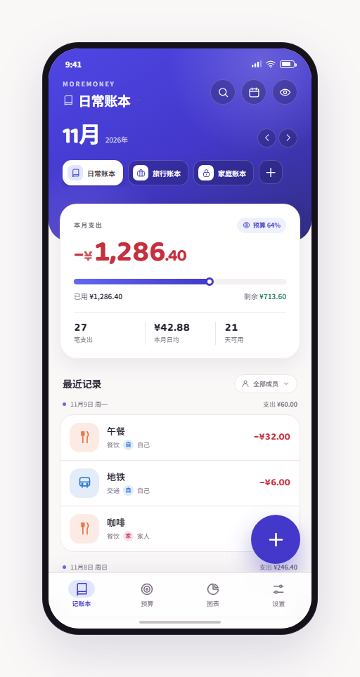</td>
<td>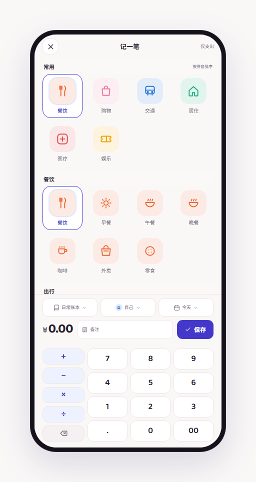</td>
</tr>
<tr>
<td>01 首页 · 浅色：Hero、预算摘要、流水、FAB</td>
<td>03 记一笔 · 浅色：分类分组、选择器、金额/备注/保存、计算器</td>
</tr>
<tr>
<td></td>
<td>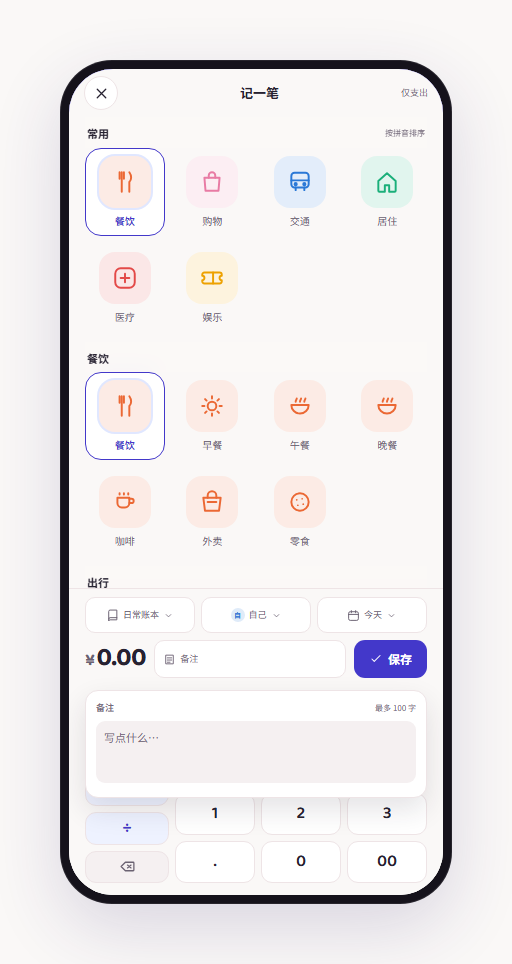</td>
</tr>
<tr>
<td>04 记一笔 · 计算状态：12 + 3 → 合计 ¥15.00</td>
<td>05 记一笔 · 备注展开：金额行保持可见，编辑器向下覆盖键盘</td>
</tr>
<tr>
<td>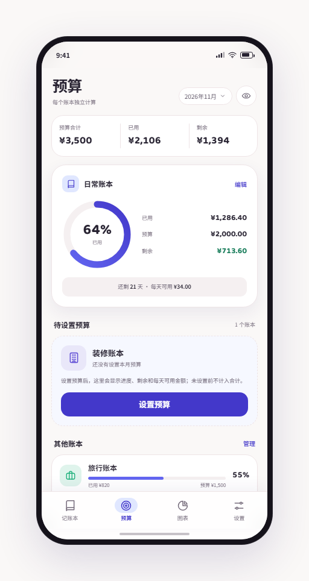</td>
<td>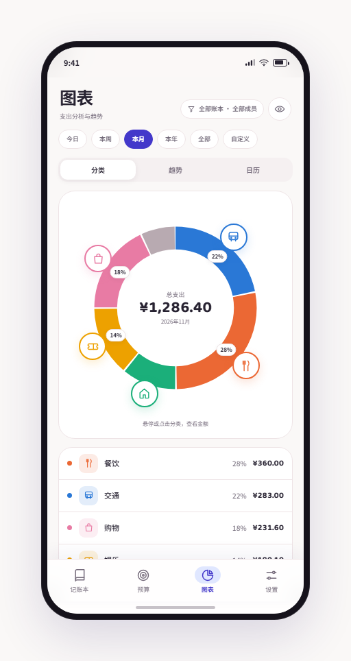</td>
</tr>
<tr>
<td>07 预算 · 浅色：预算摘要、日常预算环、待设置预算、其他账本</td>
<td>09 图表 · 分类：环形图、分类圆片、图例</td>
</tr>
<tr>
<td>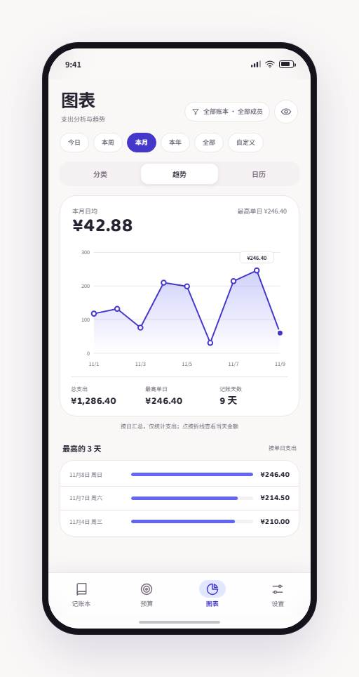</td>
<td>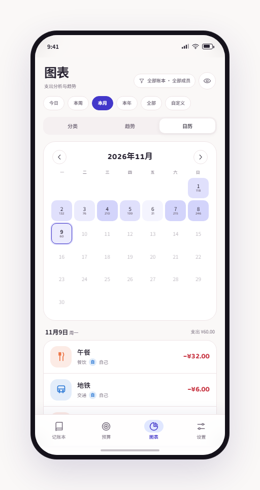</td>
</tr>
<tr>
<td>10 图表 · 趋势：每日折线、最高点、最高 3 天</td>
<td>11 图表 · 日历：每日热力、单日明细</td>
</tr>
<tr>
<td>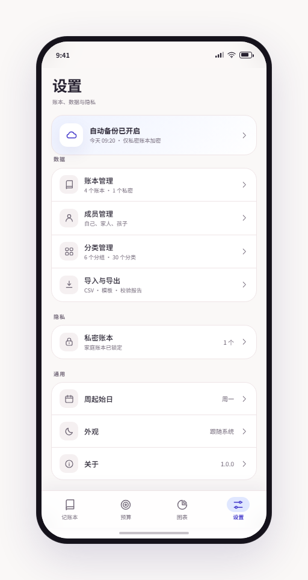</td>
<td>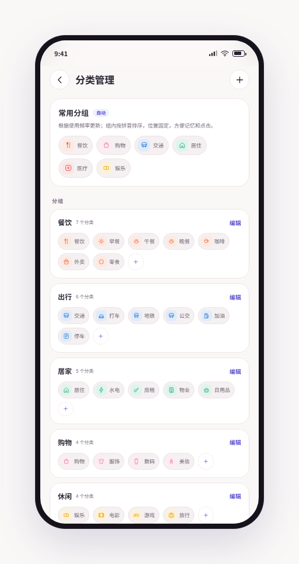</td>
</tr>
<tr>
<td>13 设置 · 浅色：备份状态、数据、隐私、通用</td>
<td>15 分类管理：常用分组、分组卡片、分类 chip</td>
</tr>
<tr>
<td>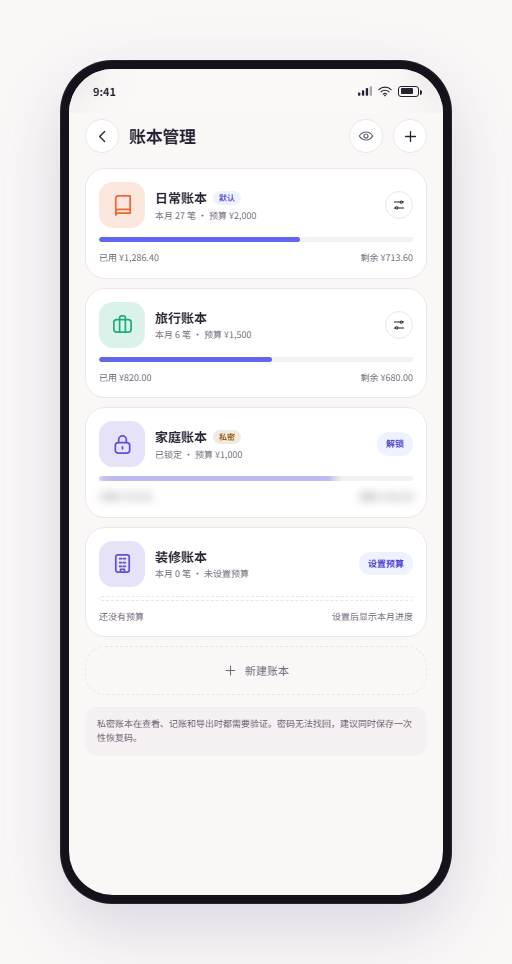</td>
<td>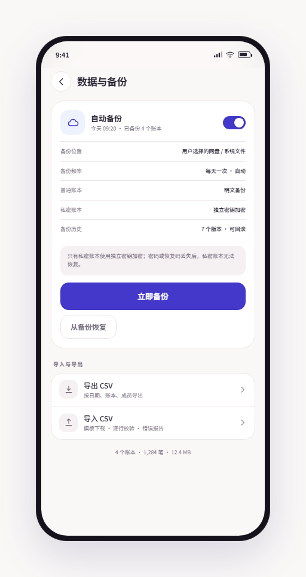</td>
</tr>
<tr>
<td>16 账本管理：日常、旅行、家庭、装修（未设置预算）</td>
<td>17 数据与备份：自动备份、备份历史、恢复、导入导出</td>
</tr>
<tr>
<td>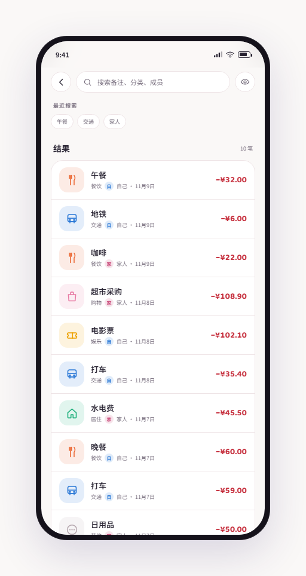</td>
<td>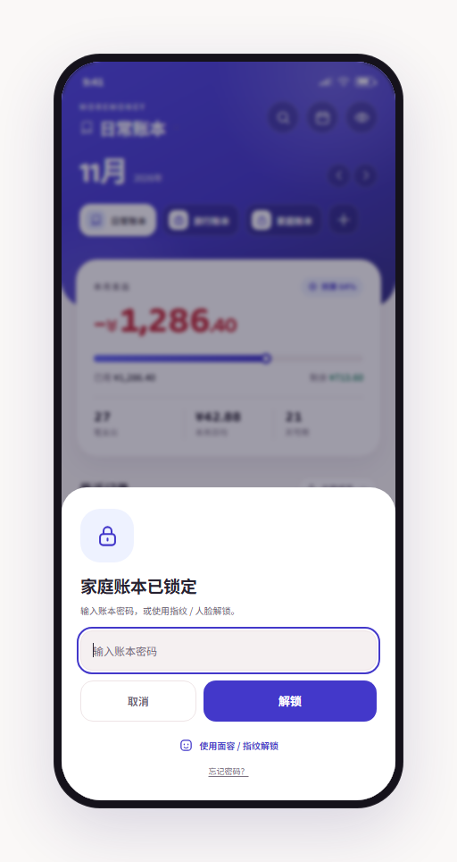</td>
</tr>
<tr>
<td>18 搜索：备注/分类/成员搜索，结果带日期</td>
<td>19 私密解锁：密码、面容/指纹、忘记密码</td>
</tr>
<tr>
<td>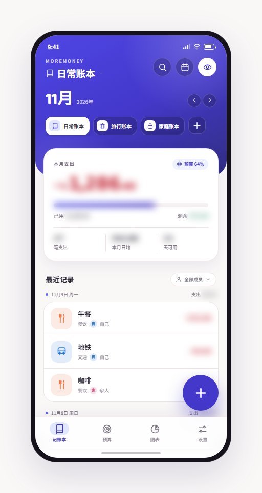</td>
<td></td>
</tr>
<tr>
<td>20 首页 · 隐藏金额：金额、统计、进度条全部模糊</td>
<td></td>
</tr>
</table>

### 12.2 深色

<table>
<tr>
<td>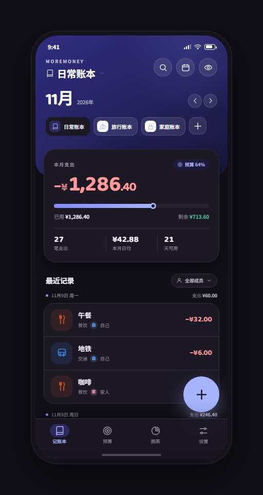</td>
<td>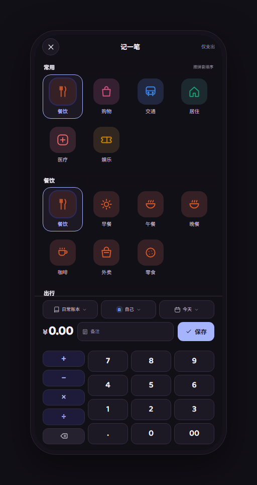</td>
</tr>
<tr>
<td>02 首页 · 深色：深靛背景、浅长春花蓝 FAB/选中态</td>
<td>06 记一笔 · 深色：分类、键盘、保存</td>
</tr>
<tr>
<td>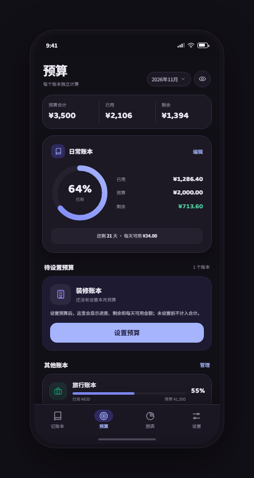</td>
<td>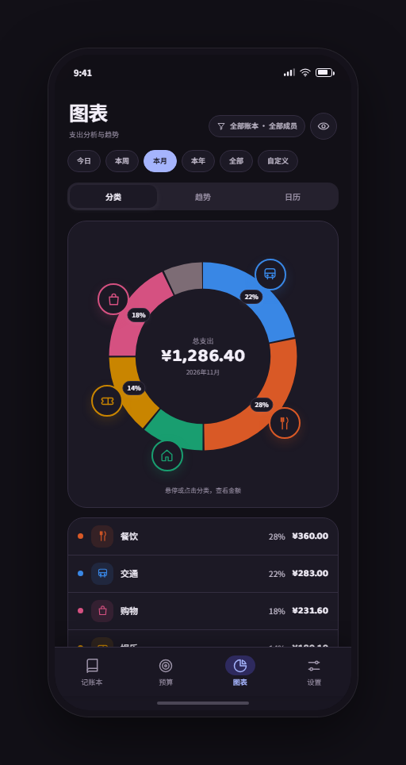</td>
</tr>
<tr>
<td>08 预算 · 深色：预算环、待设置预算、其他账本</td>
<td>12 图表 · 分类 · 深色：深色图表卡与分类色</td>
</tr>
<tr>
<td>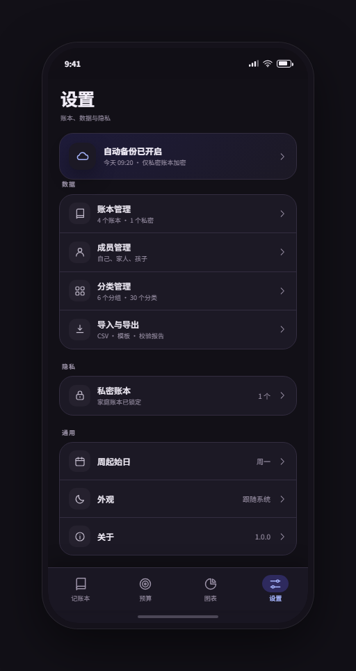</td>
<td></td>
</tr>
<tr>
<td>14 设置 · 深色</td>
<td></td>
</tr>
</table>

---

## 13. 待确认与已知限制

1. **参考图源文件缺失**：`记账.jpg`、`图表分析.jpg` 当前不在 `MoreMoney` 目录，`MoreMoney.md` 中的图片链接会失效。设计规范以现有 UI 为准。
2. **演示数据**：流水、预算、成员、分类数量均为 2026-11 的示例数据，不代表真实账本。
3. **原型行为**：账本/成员/日期选择器、设置预算、导入导出、备份等以提示代替真实流程；计算器、备注、隐藏金额、分类切换是真实交互。
4. **CSV 规范未定稿**：字段、未知项处理、重复策略需要确认。
5. **云/网盘能力未定**：需要确认目标网盘、WebDAV 或系统备份能力，以及后台自动备份的限制。
6. **预算结转未定**：v1 建议不结转，月底剩余清零。
7. **常用分组算法**：设计上按使用频率更新、按拼音固定排序；实际频率权重和更新时机需要产品确认。
8. **字号可读性**：设计稿中 8–9px 的辅助文字在 360vp 设备上偏小，落地时建议提高到 10vp 以上，或做一次窄屏字号适配。
9. **分享链接**：Claude Artifact 发布需要 claude.ai 登录；当前交付为本地 HTML 与截图，双击 `MoreMoney-UI.html` 即可查看交互原型。
